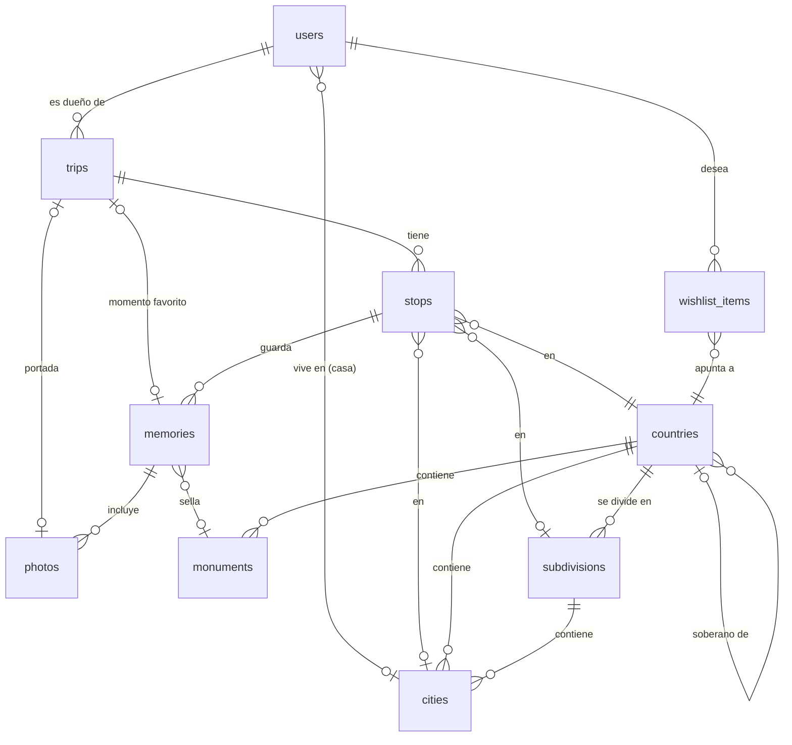

# Huella · Modelo de datos inicial

Modelo para PostgreSQL + PostGIS, manejado con SQLAlchemy 2 + GeoAlchemy2 y migraciones de Alembic. Los nombres van en inglés (ver glosario en `.claude/CLAUDE.md`); las reglas de negocio vienen de `docs/PRODUCTO.md`.

Convenciones:

- Ids de entidades del usuario: **UUID**. Ids de catálogos: enteros.
- Geometrías en **SRID 4326** (lon/lat) con índice GIST.
- Fechas de viaje y parada como `date`; `taken_at` de fotos como `timestamptz`.
- Todas las tablas del usuario llevan `user_id` y toda consulta del usuario filtra por él.
- Lo que se puede calcular (fechas del viaje, días, conteos, km de ruta, sellos, estado de cada país) **se calcula**, no se guarda.

## Diagrama

## Catálogos (globales, sin `user_id`)

### countries
| Columna | Tipo | Notas |
| --- | --- | --- |
| `id` | serial PK | |
| `iso2` | char(2) | |
| `iso3` | char(3) único | Id usado en TopoJSON y en la API |
| `iso_numeric` | char(3) | Enlaza con los ids de `world-atlas` (ej. `392` = Japón) |
| `name_es` | text | Nombre en español de México |
| `continent` | enum `america\|europe\|asia\|africa\|oceania` | Convención: 35/44/48/54/14 |
| `counts_in_progress` | bool | `true` solo para los 195 (ONU + Vaticano + Palestina) |
| `sovereign_id` | FK countries, nullable | Para territorios (Groenlandia → Dinamarca) |
| `geom` | MultiPolygon | Natural Earth 10m, para punto → país |
| `label_point` | Point | Para etiquetas y para dibujar países chicos como punto |

### subdivisions
Solo estados de México por ahora; la tabla es genérica para no migrar después.

| Columna | Tipo | Notas |
| --- | --- | --- |
| `id` | serial PK | |
| `country_id` | FK countries | |
| `code` | text único | ISO 3166-2, ej. `MX-CMX` |
| `name_es` | text | |
| `geonames_admin1` | text | Para enlazar ciudades de GeoNames |
| `geom` | MultiPolygon | Natural Earth admin-1 |

### cities
| Columna | Tipo | Notas |
| --- | --- | --- |
| `id` | int PK | geonameid de GeoNames (`cities5000`) |
| `name` | text | Nombre original |
| `name_es` | text | Nombre en español si existe, si no `name` |
| `country_id` | FK countries | |
| `subdivision_id` | FK subdivisions, nullable | Solo México |
| `location` | Point | |
| `population` | int | Para desempatar en búsqueda y geocodificación |

Índice trigram (`pg_trgm` + `unaccent`) sobre `name_es` para autocompletar.

### monuments
| Columna | Tipo | Notas |
| --- | --- | --- |
| `id` | serial PK | |
| `slug` | text único | |
| `name_es` | text | |
| `stamp_code` | text | Iniciales del sello: `TEO`, `CHI`, `MA` |
| `kind` | enum `unesco\|archaeological\|other` | |
| `country_id` | FK countries | |
| `subdivision_id` | FK subdivisions, nullable | |
| `city_id` | FK cities, nullable | |
| `location` | Point | |
| `source`, `source_ref` | text | Origen del dato (ej. `unesco`, id del sitio) |

## Datos del usuario

### users
| Columna | Tipo | Notas |
| --- | --- | --- |
| `id` | uuid PK | |
| `email` | citext único, nullable | Obligatorio desde la fase 8 |
| `handle` | text único | Para el perfil público `/u/{handle}` |
| `display_name` | text | |
| `home_city_id` | FK cities, nullable | Ciudad de casa: cuenta como visitada |
| `theme` | enum `system\|dark\|light` | Default `system` |
| `profile_public` | bool | Default `false` |
| `created_at` | timestamptz | |

En la fase 8 se agrega `password_hash` (argon2).

### trips (viajes)
| Columna | Tipo | Notas |
| --- | --- | --- |
| `id` | uuid PK | |
| `user_id` | FK users | |
| `title` | text | "Japón" |
| `summary` | text, nullable | "De Tokio a Hiroshima en tren bala…" |
| `visibility` | enum `private\|link\|public` | Default `private` |
| `share_token` | text único, nullable | Se genera al pasar a `link`; regenerable |
| `cover_photo_id` | FK photos, nullable | Si es nula, la portada es la primera foto |
| `favorite_memory_id` | FK memories, nullable | "Momento favorito" |
| `is_auto` | bool | Creado automáticamente por un recuerdo suelto |
| `created_at`, `updated_at` | timestamptz | |

Fechas, días, ciudades, monumentos, fotos y km de ruta se calculan desde las paradas.

### stops (paradas)
| Columna | Tipo | Notas |
| --- | --- | --- |
| `id` | uuid PK | |
| `trip_id` | FK trips | |
| `user_id` | FK users | Igual al del viaje (validado) |
| `position` | int | Orden en el viaje; único por (`trip_id`, `position`) |
| `visit_type` | enum `stay\|stopover` | Estancia o escala |
| `place_name` | text | Texto mostrado ("Kioto", "Aeropuerto de Tocumen") |
| `city_id` | FK cities, nullable | Nula para aeropuertos o lugares fuera de GeoNames |
| `country_id` | FK countries | Obligatorio; calculado desde el punto con PostGIS |
| `subdivision_id` | FK subdivisions, nullable | Calculado desde el punto (solo MX) |
| `location` | Point | |
| `arrived_on`, `departed_on` | date | `departed_on >= arrived_on` |
| `note` | text, nullable | "3 h en Tocumen" |

### memories (recuerdos)
| Columna | Tipo | Notas |
| --- | --- | --- |
| `id` | uuid PK | |
| `user_id` | FK users | |
| `stop_id` | FK stops | Obligatorio: todo recuerdo vive en una parada de un viaje |
| `monument_id` | FK monuments, nullable | Otorga el sello |
| `body` | text | La anécdota |
| `occurred_on` | date, nullable | Sugerida desde el EXIF |
| `visibility` | enum `private\|link\|public`, nullable | `null` = hereda del viaje |
| `created_at`, `updated_at` | timestamptz | |

### photos
| Columna | Tipo | Notas |
| --- | --- | --- |
| `id` | uuid PK | |
| `user_id` | FK users | |
| `memory_id` | FK memories, nullable | Nula mientras se sube y el recuerdo no se ha guardado |
| `position` | int | 0 = portada del recuerdo |
| `storage_key` | text | Prefijo en el `StorageBackend`; variantes `original`, `display` (2048px) y `thumb` (400px) |
| `mime`, `width`, `height`, `bytes` | | Del original guardado (siempre JPEG; HEIC y PNG se convierten). Medidas ya enderezadas |
| `sha256` | text | Evita duplicados; único por (`user_id`, `sha256`) |
| `taken_at` | timestamptz, nullable | EXIF (`DateTimeOriginal` con su `OffsetTimeOriginal`; sin zona se toma como UTC) |
| `taken_on` | date, nullable | Fecha local de la toma (reloj de la cámara). Las sugerencias de fecha la usan porque `taken_at` en UTC puede caer en otro día |
| `location` | Point, nullable | EXIF GPS |
| `created_at` | timestamptz | |

Las variantes `display` y `thumb` se guardan **sin metadatos EXIF ni perfil ICC** (convertidas a sRGB); el original conserva su EXIF y la API nunca lo sirve. Las fotos sin recuerdo con más de 24 h se borran en cada subida (índice parcial `ix_photos_orphans`).

### wishlist_items (lista de deseos)
| Columna | Tipo | Notas |
| --- | --- | --- |
| `id` | uuid PK | |
| `user_id` | FK users | |
| `country_id` | FK countries | Único por (`user_id`, `country_id`) |
| `created_at` | timestamptz | |

Después se pueden agregar `city_id` y `monument_id` con un check de "exactamente uno".

## Reglas de integridad

- `stops.user_id = trips.user_id`, `memories.user_id = stops.user_id`, `photos.user_id = memories.user_id` (validado en la capa de servicio y con pruebas).
- `trips.cover_photo_id` y `trips.favorite_memory_id` deben pertenecer al mismo viaje.
- Si `memories.visibility` tiene valor, debe ser igual o más restrictiva que `trips.visibility`. Si el viaje se vuelve más restrictivo, la visibilidad efectiva baja sola (ver abajo).
- Un recuerdo guardado sin viaje crea un viaje con `is_auto = true` y una sola parada. Al fusionarlo con otro viaje, sus paradas se mueven y el viaje automático se borra.

## Vistas derivadas (las reglas de negocio viven aquí)

- **`user_country_status`** (usuario, país): `visited` si hay al menos una parada `stay` en ese país **o** es el país de casa; `stopover` si solo hay escalas. Columna `first_visited_on` = la fecha de llegada más antigua; para la casa es nula (cuenta desde siempre) e `is_home` es verdadero. Solo los países con `counts_in_progress` suman a los 195.
- **`user_subdivision_status`**: la misma regla para estados de México.
- **`user_stamps`** (usuario, monumento): monumentos con al menos un recuerdo ligado, con la fecha del primero.
- **Visibilidad efectiva** de un recuerdo: la más restrictiva entre `trips.visibility` y `memories.visibility`, con el orden `private` < `link` < `public`. Implementada como la función SQL `effective_visibility(trip, memory)`: el enum de Postgres está declarado en ese orden, así que es `LEAST(trip, COALESCE(memory, trip))`.
- **Progreso**: conteos sobre las vistas anteriores (países 195, por continente, estados 32, ciudades distintas, sellos, viajes, fotos).
